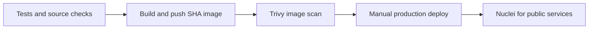

# CI quality and security gates

The pipelines follow the checks used in `tramplin1`, adapted to each service's
language and existing release process. Each repository keeps its versioned jobs in
`.gitlab/ci/security.yml`, included by `.gitlab-ci.yml`.

## Checks

| Job | Scope | Failure condition |
| --- | --- | --- |
| Existing quality jobs | Lint, types, formatting, unit/integration/browser tests appropriate to the repository | Existing checks fail |
| `gitleaks` | Current checked-out files, including documentation and infra | A secret is detected; reports redact values |
| `semgrep` | Application code with Python, C#, Go or TypeScript/JavaScript and OWASP rules | A matching finding is detected |
| `trivy-sca` | Python, Node and Go dependency files | A HIGH or CRITICAL vulnerability is detected |
| `nuget-audit` | .NET solution, including transitive dependencies | NuGet reports HIGH/CRITICAL vulnerabilities or cannot load audit data |
| `validate-k8s` / `validate_k8s` | Kustomize rendering without production credentials | Manifests cannot be rendered |
| `trivy-image` | Every image built by the pipeline, including migrator/worker variants | A HIGH or CRITICAL vulnerability is detected |
| `nuclei-scan` | Explicit public Ingress hosts after a successful manual deployment | Medium, high or critical CVE/exposure/misconfiguration findings |

Documentation and infra repositories run Gitleaks; infra also retains manifest
validation. The research repository runs its Python quality checks and source
scanners without a deployment. Existing service test commands remain in place;
state-elevator now also runs its existing unit tests. Checks run for feature
branches and merge requests, with duplicate push/MR pipelines suppressed.

All security jobs are blocking. Image builds wait for source checks. Production
deployment waits for image scanning even when it uses `needs`. Publishing an
image to the registry does not deploy it. Existing manual production confirmation,
GitLab Agent contexts, migrations, environment settings and rollout commands are
preserved. Nuclei runs only after the corresponding production deploy; it uses a
30 requests/second limit and does not use external interaction callbacks.
Scheduled infra backups do not wait for security scans.

## Reports and maintenance

Download the `security-reports/` artifacts from the relevant job; retention is
seven days. Gitleaks and Trivy produce JSON, Semgrep produces JSON and SARIF,
NuGet Audit produces a log, and Nuclei produces JSONL. A failed scanner is not
silently treated as a pass. Findings require reviewing the report and fixing the
code, dependency or base image before the next release; these jobs do not update
application dependencies automatically.

Scanner versions are pinned to match the reference pipeline: Gitleaks 8.30.1,
Semgrep 1.172.0, Trivy 0.74.0 and Nuclei 3.11.0. Vulnerability databases and public
Semgrep/Nuclei rules update independently. Update the local job files and validate
with GitLab CI Lint when changing the tool versions or policies.

The .NET source audit uses NuGet rather than relying on Trivy filesystem scanning
of `.csproj` files. Trivy additionally scans the resolved runtime dependencies in
the published container image.

Reviewed Gitleaks exceptions match only specific synthetic fixture values, variable
names, an ellipsis private-key placeholder and 16-digit research cache hashes in
specified files. They retain the default rules and do not exclude whole test or
research directories. Semgrep parser diagnostics are retained in its reports;
native language builds and tests remain part of verification.

Python production images now use patched Alpine runtimes, separate dependency-build
stages and numeric non-root users. UV and build toolchains stay in the builder.
Runtime images are scanned without ignoring unfixed vulnerabilities. The Nuclei
concurrency is five; the unchanged template set runs at 30 requests/second so it
fits the scan timeout.
